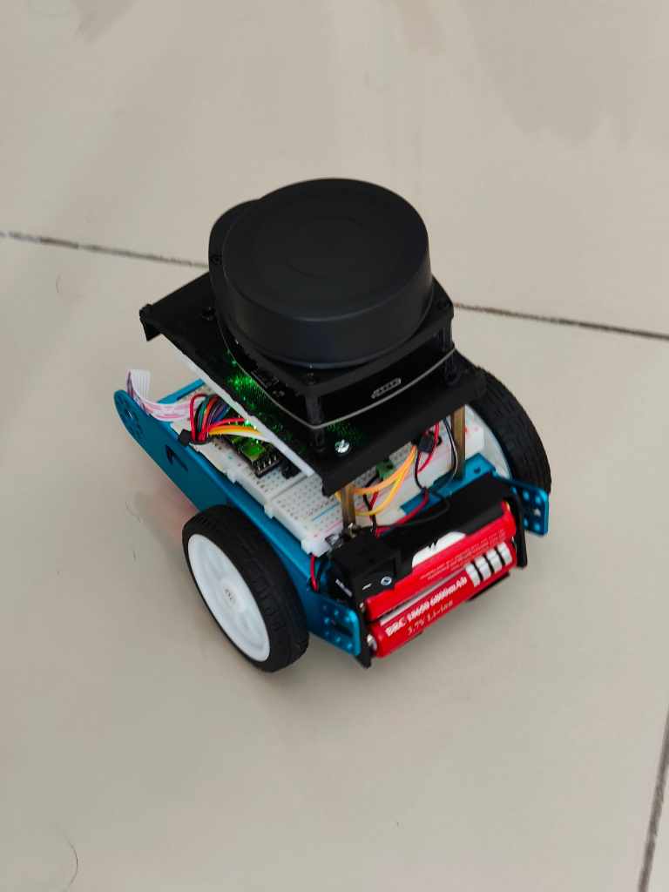
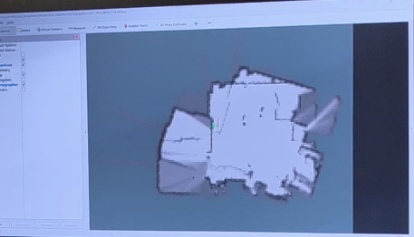

# SLAM LiDAR Car: From Hardware Experiments to ROS 2 Mapping

I built a small differential-drive robot to learn how LiDAR, wheel encoders,
embedded control, and PC-side robotics software work together. The project
started with Arduino/ESP32 experiments and developed into a Kaia.ai-based ROS 2
mapping prototype.



**Current result:** driving, live LiDAR, and experimental mapping work. I now
have a stable map, but reliable ROS 2 Nav2 navigation is unfinished. Navigation
still needs careful, often tedious calibration, time alignment, startup checks,
and repeated physical testing. This is an engineering learning project, not a
turnkey autonomous robot.

## What I achieved

| Area | Result | Limit |
|---|---|---|
| Hardware integration | Assembled the car, LiDAR, motor driver, controller, and encoders | Wiring and controller revisions need separate verification |
| Manual driving | Forward/backward and turning were exercised during development | Direction/channel mistakes and asymmetric reverse travel needed investigation |
| LiDAR and ROS 2 | Streamed telemetry to the host and published scans, odometry, joints, and transforms | A running topic alone does not prove useful sensor data |
| Mapping | Produced indoor maps; my latest result is stable mapping | Photos do not measure map accuracy or prove navigation |
| Timing investigation | Corrected scan-duration handling and rejected non-increasing telemetry | Large moving-yaw jumps were not conclusively attributed or cured |
| Regression testing | Added offline timing/order tests and a recorded-data replay tool | Stationary results are not moving-navigation acceptance tests |
| Nav2 | Investigated the setup and integration | Repeatable, reliable autonomous navigation remains future work |

## How the used system fits together

```text
RPLIDAR A1 ---- UART ----> ESP32-S3 running Kaia.ai-derived firmware
Wheel encoders ----------> |                  |
                           |                  +----> DRV8833 ----> motors
                           |
                    Wi-Fi / micro-ROS
                           |
                     PC running ROS 2
                           |
               corrected kaiaai_telemetry
                           |
              scans + odometry + TF + joints
                           |
                Cartographer / RViz mapping
                           |
                Nav2 commissioning (unfinished)
```

The Arduino motor-control variant belongs to earlier experiments. It is **not**
an extra motor-controller stage in the later ESP32-controlled implementation.
ROS 2 does the host-side work; the ESP32 handles embedded sensing and drive.

## Project evolution

- **Original `slam` work:** separate LiDAR/Wi-Fi and motor-control experiments,
  followed by combined-car work. Custom visualization and mapping approaches
  helped me understand the data flow.
- **`SLAM V2` experience:** a more structured ROS 2 Jazzy approach with
  calibration handling, scan-only bringup, and safety/acceptance gates.
  Synthetic bench results were not proof of physical autonomy, and blocked
  physical gates were not treated as completed tests.
- **Used Kaia.ai integration:** Kaia.ai firmware and the corrected
  `kaiaai_telemetry` bridge form the selected implementation represented here.
  V2 is discussed as engineering experience, not published as a second final
  deployed stack.

Read the [full project conclusion](docs/project-conclusion.md) for the debugging
story, measurements, lessons, and improvement plan.

## Mapping results



*A mapping result from my project. I report stable mapping now; this image does
not establish map accuracy, successful localization, or completed Nav2 missions.*

*The exact software revision for this map photo is not established; it is
not assigned to a specific project version. A second mapping photo was
omitted from publication for privacy.*

## Hardware and power notes

- RPLIDAR A1, differential-drive chassis, wheel encoders, and DRV8833.
- Replacement ESP32-S3 MakerHub/Smith3D N16R8 carrier in the later work.
  A mounted camera was reported, but camera operation was not verified.
- I installed a **0.1 uF capacitor across the LiDAR 5 V and GND**.
- I installed a **100 uF capacitor across the DRV8833 7.4 V and GND**.

These are two separate rail-to-ground capacitors, intended for local decoupling
and bulk buffering respectively. Their effectiveness was not measured; they
are not a demonstrated yaw fix. Component voltage ratings and polarity are not
verified by this documentation. Check the actual components and hardware
specifications before powering a replica.

The [supplied wiring reference](docs/images/wiring-reference.jpg) retains its
original source-of-truth and placement warnings. It is **not** an independently
verified as-built schematic, and it must not be assumed to match the replacement
S3 pinout or every hardware revision.

## What code is included

| Location | Purpose |
|---|---|
| [`ros_ws/src/kaiaai_telemetry`](ros_ws/src/kaiaai_telemetry/README.md) | Used ROS bridge, required decoder dependencies, build/config files, license, and timing regression/replay tool |
| [`firmware`](firmware/README.md) | S3 configuration reference and explicit firmware provenance limits |
| [`docs/project-conclusion.md`](docs/project-conclusion.md) | Retrospective, evidence limits, and improvements |
| [`THIRD_PARTY_NOTICES.md`](THIRD_PARTY_NOTICES.md) | Upstream credits, licensing, and modification notices |

**Exact flashed firmware source is unavailable in this release.** The surviving
local source contains later, unflashed changes, so I have not presented it as a
reproducible final firmware build. No firmware binary, Wi-Fi credentials, flash
backup, or guessed replacement sketch is included.

Only the selected bridge and its dependency closure are released. The root
`Arduino Motor Driver` and `RPlidar Testing` prototypes were superseded and
removed from the current tree; they remain in Git history. Alternate V2
applications, unused test publishers, duplicate stacks, build products, raw
bags, and private diagnostics are not part of the release. Original local
project folders were preserved.

## Build and test

See the [bridge build and offline test guide](ros_ws/src/kaiaai_telemetry/README.md).
The standalone regression needs only Python 3 and a C++17 compiler. The complete
bridge needs ROS 2 Jazzy and the matching upstream `kaiaai_msgs` interfaces.
This repository is **not** a complete robot bringup or flashing kit.

Do not drive from these instructions. Physical commissioning must first prove
an independent motor cutoff, exclusive command control, correct wheel
directions, and safe command-timeout behavior.

## Credits and project relationship

This independent build draws on [Maker's Pet](https://makerspet.com/) hardware
resources and the [Kaia.ai](https://kaia.ai/) robotics platform. Their firmware,
ROS integration, and examples were important foundations for my work. This is
attribution, **not an official affiliation, partnership, or endorsement**.

- [Kaia.ai platform](https://github.com/kaiaai/kaiaai)
- [Kaia.ai firmware](https://github.com/kaiaai/firmware)
- [Kaia.ai telemetry bridge](https://github.com/kaiaai/kaiaai_telemetry)
- [Maker's Pet projects](https://github.com/makerspet)
- [ROS 2](https://docs.ros.org/en/jazzy/), [Cartographer](https://github.com/cartographer-project/cartographer_ros),
  and [Nav2](https://docs.nav2.org/)

My work is the car integration, wiring and power experiments, configuration,
calibration/debugging effort, timing/order corrections, and this documented
evaluation. Imported code remains under its own license: the root
[MIT license](LICENSE) does **not** replace the bridge and firmware-reference
[Apache-2.0 notices](THIRD_PARTY_NOTICES.md).
